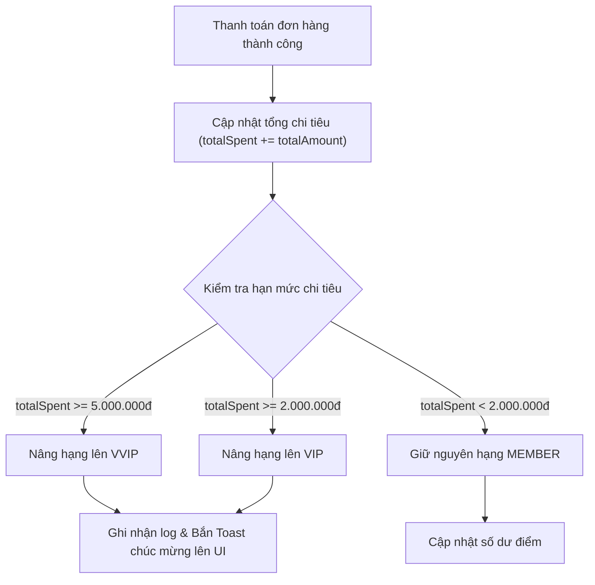

# Cinema Membership & Loyalty Program — Skill Guide

Tài liệu này chuẩn hóa toàn bộ nghiệp vụ **Chương Trình Khách Hàng Thân Thiết (CGV Membership)**, quản lý thẻ thành viên số và cơ chế tích/tiêu điểm thưởng trong hệ thống rạp chiếu phim.

---

## 1. Cấu Trúc Phân Hạng Thành Viên (Membership Tiers)

Hệ thống phân định 3 cấp bậc thành viên với các quyền lợi lũy tiến:

| Cấp Bậc | Hạn Mức Chi Tiêu Tích Lũy | Tỷ Lệ Tích Điểm | Đặc Quyền Thành Viên |
| :--- | :--- | :--- | :--- |
| **MEMBER** | 0 – 1.999.000 VNĐ | **5%** tổng giá trị vé | Giá vé ưu đãi ngày thứ 4 (Happy Wednesday), tích điểm đổi vé và bắp nước. |
| **VIP** | 2.000.000 – 4.999.000 VNĐ | **7%** tổng giá trị vé | Tặng 02 vé 2D miễn phí sinh nhật, giảm 10% tại quầy bắp nước F&B, lối vào rạp ưu tiên. |
| **VVIP** | Từ 5.000.000 VNĐ trở lên | **10%** tổng giá trị vé | Tặng 04 vé IMAX/3D sinh nhật, miễn phí nâng cấp Sweetbox, phòng chờ VIP Lounge, quà tri ân cuối năm. |

---

## 2. Quy Chế Điểm Thưởng (CGV Points System)

### 2.1. Công Thức Tích Điểm
Mỗi khi khách hàng thanh toán vé xem phim hoặc combo bắp nước thành công:
$$\text{Điểm Tích Lũy} = \left\lfloor \frac{\text{Tổng Tiền Thanh Toán} \times \text{Tỷ Lệ Hạng}}{1.000} \right\rfloor$$

*Ví dụ: Khách hàng hạng **VIP** (7%) mua đơn vé trị giá **250.000 VNĐ**:*
$$\text{Điểm} = \left\lfloor \frac{250.000 \times 0.07}{1.000} \right\rfloor = 17 \text{ Điểm CGV}$$

### 2.2. Quy Tắc Tiêu Điểm
* Tỷ lệ quy đổi: **1 Điểm CGV = 1.000 VNĐ**.
* Điểm có thể dùng để thanh toán một phần hoặc toàn bộ giá trị đơn vé.
* Số điểm tối thiểu cho mỗi lần đổi: **10 điểm** (tương đương 10.000 VNĐ).

---

## 3. Quản Lý Thẻ Thành Viên Số (Digital CGV Card)

Mỗi người dùng khi đăng ký tài khoản thành công sẽ được cấp một số thẻ ảo duy nhất:

### 3.1. Thuật Toán Sinh Số Thẻ 16 Ký Tự
Format chuẩn: `9999-XXXX-XXXX-XXXX`
```javascript
function generateCGVCardNumber() {
  const prefix = "9999";
  const part1 = Math.floor(1000 + Math.random() * 9000);
  const part2 = Math.floor(1000 + Math.random() * 9000);
  const part3 = Math.floor(1000 + Math.random() * 9000);
  return `${prefix}-${part1}-${part2}-${part3}`;
}
```

### 3.2. Hiển Thị Thẻ Thành Viên Trên Giao Diện ([index.html](file:///c:/Users/Admin/OneDrive/Tài%20liệu/Hệ-Thống-Quản-Lý-Rạp-Chiếu-Phim/frontend/index.html))
Giao diện `account-view` mô phỏng thẻ thành viên sang trọng phong cách CGV Black Card:
* Mặt trước: Logo CGV Gold, Số thẻ dập nổi, Họ tên khách hàng, Hạng thẻ (MEMBER/VIP/VVIP) kèm huy hiệu ánh kim, Số dư điểm CGV Points.
* Mã vạch/QR tích điểm để nhân viên tại quầy có thể quét tích điểm trực tiếp.

---

## 4. Bảng Mã Giảm Giá & Voucher Tự Động (Discount Engine)

Hệ thống tích hợp bảng chiết khấu thông minh tại `BookingAgent` ([bookingAgent.js](file:///c:/Users/Admin/OneDrive/Tài%20liệu/Hệ-Thống-Quản-Lý-Rạp-Chiếu-Phim/backend/src/agents/bookingAgent.js)):

| Mã Voucher | Tỷ Lệ Giảm | Điều Kiện Áp Dụng |
| :--- | :--- | :--- |
| `HSSV20` | **20%** | Dành cho Học sinh - Sinh viên (áp dụng từ Thứ 2 đến Thứ 6). |
| `MEMBER10` | **10%** | Dành cho thành viên CGV Member trong ngày thành viên. |
| `COUPLE15` | **15%** | Tự động áp dụng khi khách hàng đặt từ 02 ghế SWEETBOX trở lên. |
| `BIRTHDAY30` | **30%** | Dành cho khách hàng trong tháng sinh nhật. |
| `FIRSTBUY5` | **5%** | Dành cho khách hàng thực hiện đơn đặt vé đầu tiên trên hệ thống. |

---

## 5. Quy Trình Nâng Hạng Tự Động (Tier Upgrade Workflow)



---

## 6. Bảo Mật & Toàn Vẹn Thông Tin Cá Nhân

1. **Không lưu hoặc trả về mật khẩu dạng plain-text**: API `GET /api/v1/auth/me` và `GET /api/v1/users` luôn loại bỏ trường `password` trước khi trả về client.
2. **Phiên đăng nhập an toàn**: Token mang thời hạn TTL 24 giờ (`TOKEN_TTL_MS = 24 * 60 * 60 * 1000`).
3. **Chống giả mạo điểm thưởng**: Việc cộng/trừ điểm CGV Points chỉ được thực hiện tại tầng Backend thông qua Database Transaction, nghiêm cấm client gửi trường điểm để ghi đè.
