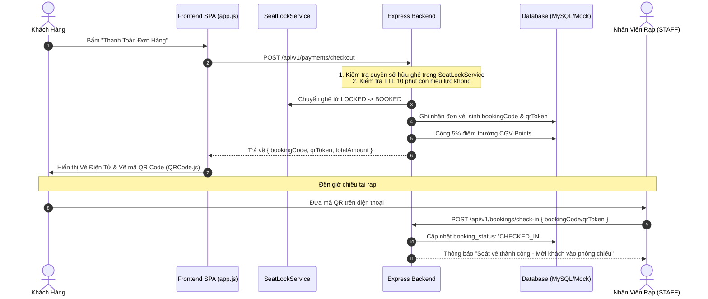

# Cinema Payment & E-Ticketing System — Skill Guide

Tài liệu này chuẩn hóa toàn bộ quy trình **Thanh toán Trực tuyến, Phát hành Vé Điện Tử (E-Ticket) và Nghiệp vụ Soát Vé QR** trong hệ thống rạp chiếu phim.

---

## 1. Kiến Trúc Luồng Thanh Toán (Payment Workflow)

Quy trình thanh toán được thiết kế nghiêm ngặt nhằm ngăn chặn tuyệt đối tình trạng gian lận, xung đột ghế (Race Condition) và thanh toán trùng lặp (Double-Spending):



---

## 2. Phương Thức Thanh Toán Hỗ Trợ

Hệ thống hỗ trợ 4 hình thức thanh toán linh hoạt:

1. **Ví điện tử MoMo / ZaloPay / VNPay (QR Code Gateway)**:
   * Mô phỏng cổng thanh toán tức thời với mã giao dịch đối soát tự động.
2. **Thẻ Quốc tế (Visa / MasterCard / JCB)**:
   * Kiểm tra định dạng số thẻ (Luhn Algorithm) và mô phỏng 3D-Secure OTP.
3. **Thẻ ATM Nội địa / Internet Banking**:
   * Mô phỏng cổng Napas thanh toán trực tiếp qua tài khoản ngân hàng.
4. **Đổi Điểm Thưởng CGV Points**:
   * Khách hàng VIP/VVIP có thể dùng điểm tích lũy để thanh toán hoặc khấu trừ trực tiếp vào hóa đơn (Tỷ lệ quy đổi: **1 điểm CGV = 1.000 VNĐ**).

---

## 3. Cấu Trúc Mã Vé & Bảo Mật QR Code Chống Làm Giả

### 3.1. Định dạng Mã Đặt Vé (`bookingCode`)
* Format: `BKG-XXXXXX` (Ví dụ: `BKG-78A9B2`).
* Chuỗi ngẫu nhiên 6 ký tự hex kết hợp timestamp để đảm bảo tính duy nhất trên toàn hệ thống.

### 3.2. Mã Bảo Mật QR Token (`qrToken`)
Để chống việc người dùng tự chỉnh sửa mã vé để vào rạp, mỗi vé phát hành kèm một chữ ký mã hóa:
```javascript
function generateSecureQRToken(bookingCode, showtimeId, seatIds) {
  const secretKey = process.env.QR_SECRET || "cgv_cinema_secret_2026";
  const rawPayload = `${bookingCode}:${showtimeId}:${seatIds.sort().join(",")}:${Date.now()}`;
  // Sinh mã băm bảo mật HMAC-SHA256 mô phỏng
  const hash = Buffer.from(rawPayload + secretKey).toString("base64url");
  return `QR_${bookingCode}_${hash.substring(0, 16)}`;
}
```

### 3.3. Hiển thị QR Code trên Frontend ([app.js](file:///c:/Users/Admin/OneDrive/Tài%20liệu/Hệ-Thống-Quản-Lý-Rạp-Chiếu-Phim/frontend/src/app.js))
Frontend sử dụng thư viện `QRCode.js` render trực tiếp mã QR sắc nét trên canvas để nhân viên dùng điện thoại hoặc máy quét mã vạch chuyên dụng đọc dữ liệu:
```javascript
new QRCode(document.getElementById("ticket-qrcode"), {
  text: JSON.stringify({
    code: booking.bookingCode,
    token: booking.qrToken,
    showtime: booking.showtimeId,
    seats: booking.seatIds
  }),
  width: 160,
  height: 160,
  colorDark: "#000000",
  colorLight: "#ffffff",
  correctLevel: QRCode.CorrectLevel.H // Độ chịu lỗi cấp cao (30%)
});
```

---

## 4. Nghiệp Vụ Soát Vé & Check-In (Phân Hệ STAFF)

Nhân viên tại rạp kiểm soát vé qua giao diện **Quầy Soát Vé** (`staff-view`):

### 4.1. Quy tắc Xác thực Check-In
1. **Kiểm tra trạng thái thanh toán**: Phải là `PAID` (đã thu tiền).
2. **Kiểm tra trạng thái vé**:
   * Nếu là `CONFIRMED`: Hợp lệ -> Chuyển thành `CHECKED_IN` và ghi nhận thời gian vào phòng chiếu.
   * Nếu đã là `CHECKED_IN`: **Cảnh báo gian lận** (Vé này đã được quét trước đó, từ chối cho vào).
   * Nếu là `CANCELLED` hoặc `REFUNDED`: **Từ chối** (Vé đã bị hủy hoặc hoàn tiền).
3. **Kiểm tra thời gian suất chiếu**: Cảnh báo nếu khách vào sai phòng chiếu hoặc sai ngày/giờ.

### 4.2. Endpoint Check-in
```http
POST /api/v1/bookings/check-in
Authorization: Bearer <staff_token>
Content-Type: application/json

{
  "bookingCode": "BKG-78A9B2"
}
```

---

## 5. Quy Trình Hoàn Tiền Vé Tự Động (Refund Workflow)

Khi khách hàng có nhu cầu hủy vé, hệ thống tự động đánh giá qua `CustomerServiceAgent`:

```
                  [ Khách Yêu Cầu Hoàn Vé ]
                              │
                              ▼
           [ Tính Khoảng Cách Đến Giờ Chiếu (Δt) ]
                              │
             ┌────────────────┼────────────────┐
             ▼                                 ▼
      Δt > 24 Giờ                        2h <= Δt <= 24h
   Hoàn 100% Giá Trị                     Hoàn 50% Giá Trị
   (Phí xử lý: 0đ)                       (Thu phí 50%)
             │                                 │
             └────────────────┬────────────────┘
                              ▼
      [ Cập nhật trạng thái Booking sang REFUNDED ]
                              ▼
      [ Giải phóng ghế trong SeatLockService -> AVAILABLE ]
                              ▼
      [ Trừ lại điểm CGV Points đã tích lũy từ đơn vé này ]
```

*Trường hợp suất chiếu còn **dưới 2 giờ** (< 2h): Hệ thống tự động từ chối hoàn vé theo quy định để đảm bảo quyền lợi vận hành của rạp.*
