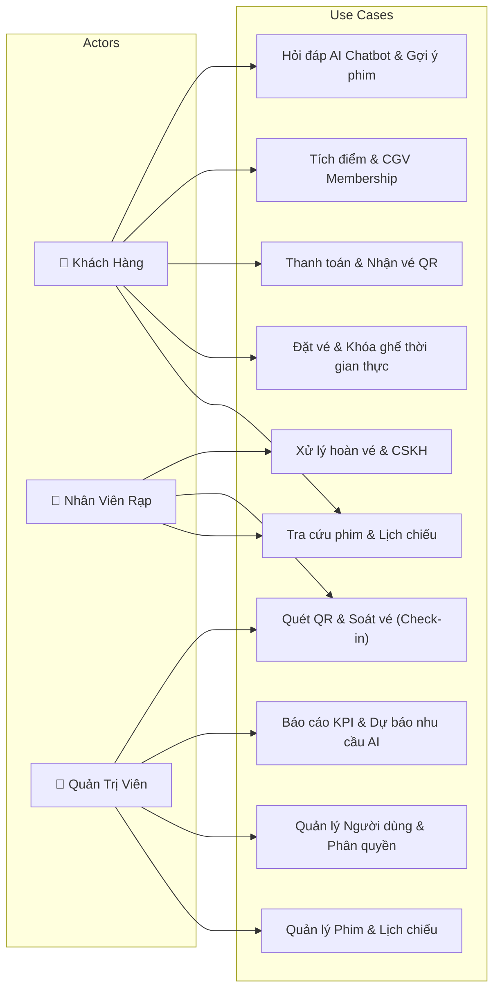
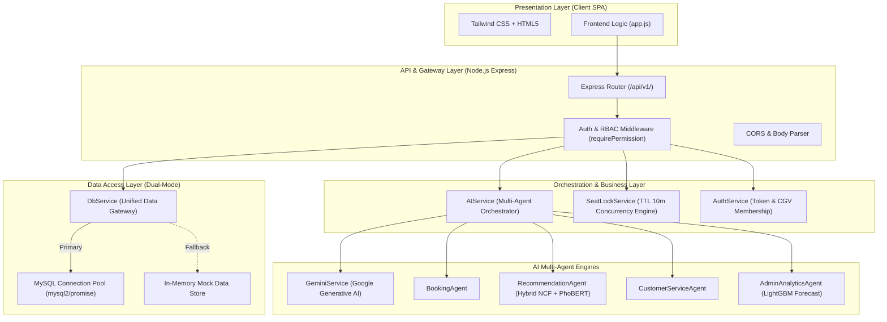
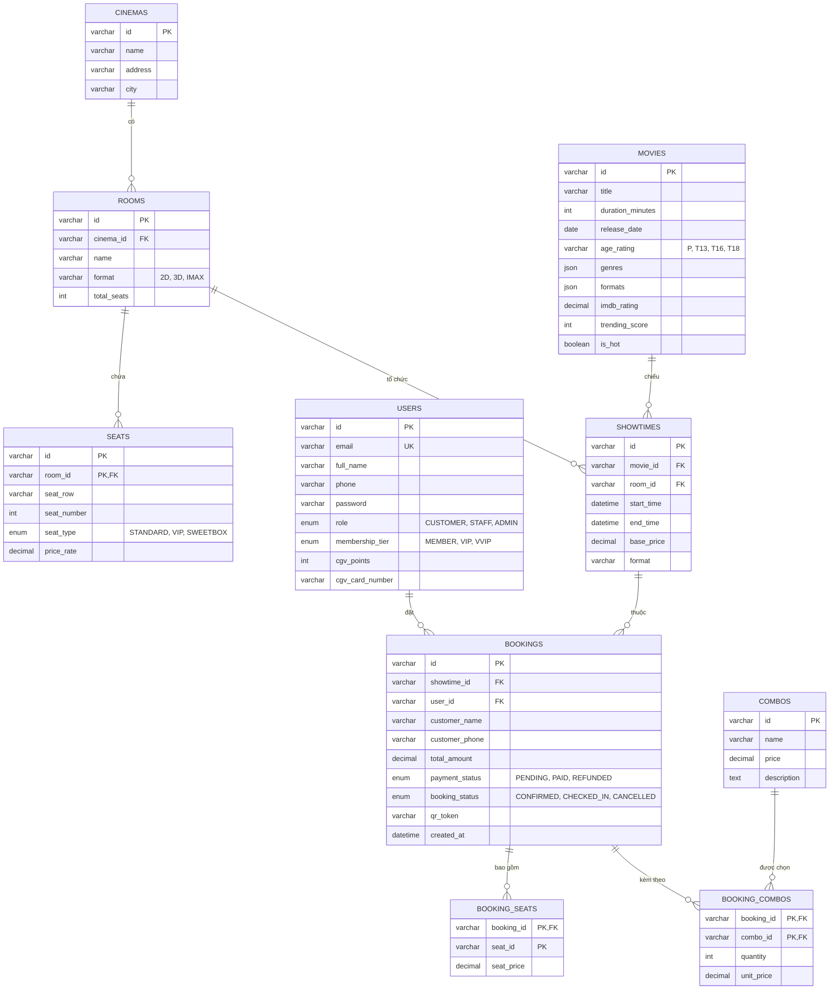

# Cinema System Analysis & Architecture Design — Skill Guide

Skill này chuẩn hóa toàn bộ quy trình **Phân tích Yêu cầu & Thiết kế Kiến trúc Hệ thống** cho dự án Quản Lý Rạp Chiếu Phim Tích Hợp AI, phục vụ công tác phát triển, kiểm tra kiến trúc và trình bày báo cáo đồ án tốt nghiệp.

---

## 1. Phân Tích Yêu Cầu Hệ Thống (Requirements Engineering)

### 1.1. Yêu cầu Chức năng (Functional Requirements - FR)
* **Phân hệ Khách hàng (FR-CUST)**:
  * Xem danh mục phim đang chiếu, sắp chiếu, trailer, chi tiết phim.
  * Tìm kiếm, lọc phim theo tên, thể loại, định dạng (2D, 3D, IMAX).
  * Xem lịch chiếu theo cụm rạp, chọn suất chiếu, xem sơ đồ ghế ngồi theo thời gian thực.
  * Đặt vé, chọn ghế ngồi (Standard, VIP, Sweetbox) với cơ chế giữ ghế tạm thời (Locking).
  * Chọn mua kèm combo bắp nước F&B.
  * Áp dụng mã giảm giá / khuyến mãi (HSSV, Thành viên, Sinh nhật).
  * Thanh toán đơn hàng, nhận vé điện tử kèm mã QR Code chống làm giả.
  * Đăng ký, đăng nhập tài khoản CGV Membership, tra cứu lịch sử mua vé, tích và tiêu điểm.
  * Tương tác với AI Chatbot để nhận tư vấn suất chiếu và gợi ý phim cá nhân hóa.

* **Phân hệ Nhân viên rạp (FR-STAFF)**:
  * Đăng nhập tài khoản nghiệp vụ rạp.
  * Tra cứu thông tin đơn vé theo mã vé (`bookingCode`) hoặc thông tin khách hàng.
  * Quét mã QR / Check-in vé khách hàng khi vào phòng chiếu, chuyển trạng thái vé sang `CHECKED_IN`.
  * Hỗ trợ khách hàng đổi trả/hoàn vé tại quầy theo chính sách thời gian.

* **Phân hệ Quản trị viên (FR-ADMIN)**:
  * Quản lý danh mục phim: Thêm, sửa, cập nhật trạng thái (Đang chiếu, Sắp chiếu, Ngừng chiếu).
  * Quản lý phòng chiếu và sơ đồ ghế (Standard, VIP, Sweetbox, tỷ lệ giá).
  * Quản lý suất chiếu (Showtimes): Tạo lịch chiếu, kiểm tra xung đột thời gian và phòng chiếu.
  * Quản lý người dùng và phân quyền (RBAC: CUSTOMER, STAFF, ADMIN).
  * Xem báo cáo doanh thu, tỷ lệ lấp đầy phòng chiếu (Occupancy Rate) theo ngày/tuần.
  * Sử dụng AI Analytics: Dự báo nhu cầu giờ cao điểm và gợi ý lịch chiếu tối ưu doanh thu.

### 1.2. Yêu cầu Phi chức năng (Non-Functional Requirements - NFR)
* **Tính sẵn sàng & Khả năng chịu lỗi (Fault Tolerance)**: Hệ thống hoạt động song song Dual-Mode (MySQL 8.0+ và In-Memory Fallback), tự động chuyển đổi khi database mất kết nối.
* **Tính toàn vẹn dữ liệu & Chống xung đột (Concurrency Control)**: Đảm bảo không xảy ra tình trạng "Double Booking" (2 khách cùng mua 1 ghế) bằng cơ chế Distributed In-Memory Lock với TTL 10 phút.
* **Bảo mật & Phân quyền (Security)**: Xác thực Bearer Token, mã hóa dữ liệu nhạy cảm, kiểm soát quyền truy cập RBAC nghiêm ngặt ở cả tầng API và Frontend.
* **Hiệu năng & Thời gian phản hồi (Performance)**: Thời gian phản hồi API < 200ms cho các tác vụ tra cứu, AI Gemini phản hồi trong 1-2s.

---

## 2. Ma Trận Tác Nhân & Sơ Đồ Use Case (Use Case Modeling)



---

## 3. Kiến Trúc Hệ Thống (Layered Architecture)

Hệ thống được thiết kế theo mô hình **Kiến trúc Phân tầng (Layered Clean Architecture)** giúp phân tách độc lập các mối quan tâm:



---

## 4. Thiết Kế Cơ Sở Dữ Liệu Quan Hệ (ERD - 8 Bảng Cốt Lõi)

Dữ liệu được chuẩn hóa đạt dạng chuẩn **3NF**, hỗ trợ đầy đủ tiếng Việt và Emoji qua mã hóa `utf8mb4_unicode_ci`:



---

## 5. Thiết Kế State Machine (Vòng Đời Trạng Thái)

### 5.1. Vòng đời Ghế Ngồi (Seat State Machine)
```
[ AVAILABLE (Trống) ]
        │
        │ Khách click chọn ghế (POST /api/v1/bookings/lock-seats)
        ▼
[ LOCKED (Khóa tạm thời - TTL 10 phút) ]
        │
        ├── Hết 10 phút chưa thanh toán / Hủy chọn ──► [ AVAILABLE ]
        │
        │ Thanh toán thành công (POST /api/v1/payments/checkout)
        ▼
[ BOOKED (Đã thanh toán) ]
        │
        │ Hoàn vé được duyệt (POST /api/v1/support/refund)
        ▼
[ AVAILABLE (Mở bán lại) ]
```

### 5.2. Vòng đời Đơn Đặt Vé (Booking State Machine)
```
[ PENDING ] (Đang chờ thanh toán)
    │
    ├── Thanh toán thành công ──► [ CONFIRMED ] (Đã có mã vé & QR)
    │                                  │
    │                                  ├── Nhân viên quét QR ──► [ CHECKED_IN ]
    │                                  │
    │                                  └── Khách yêu cầu hoàn vé ──► [ REFUNDED ]
    │
    └── Quá thời hạn / Hủy bỏ ──► [ CANCELLED ]
```

---

## 6. Chuẩn Thiết Kế RESTful API Convention

* **Quy tắc Base URL**: `/api/v1/{resource}`
* **Quy ước Method**:
  * `GET`: Lấy thông tin (Idempotent, Safe).
  * `POST`: Tạo mới tài nguyên hoặc hành động nghiệp vụ (Create / Action).
  * `PUT`: Cập nhật toàn diện tài nguyên.
  * `PATCH`: Cập nhật một phần tài nguyên.
  * `DELETE`: Xóa tài nguyên.
* **Cấu trúc Response Chuẩn**:
  ```json
  // Khi thành công:
  {
    "status": "SUCCESS",
    "data": { ... },
    "message": "Thông báo thân thiện"
  }

  // Khi có lỗi:
  {
    "status": "ERROR" | "CONFLICT" | "FORBIDDEN",
    "message": "Mô tả nguyên nhân lỗi cụ thể"
  }
  ```
