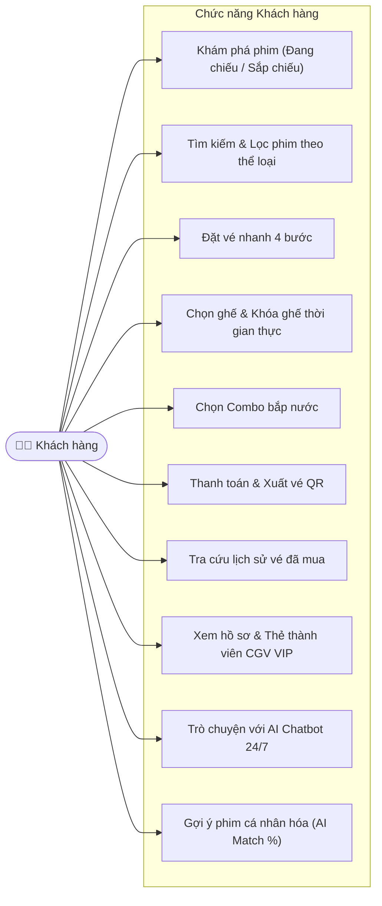
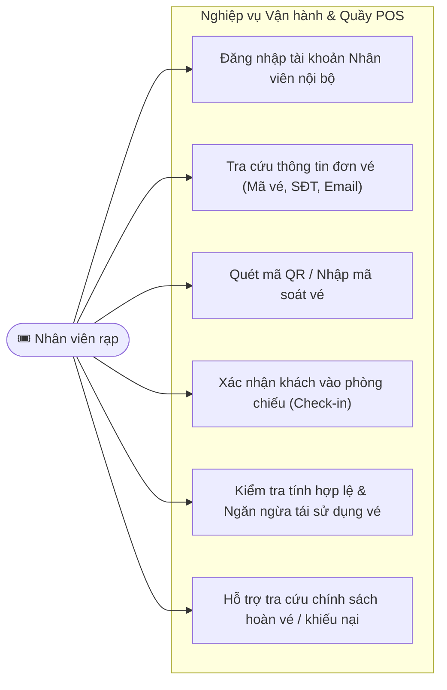
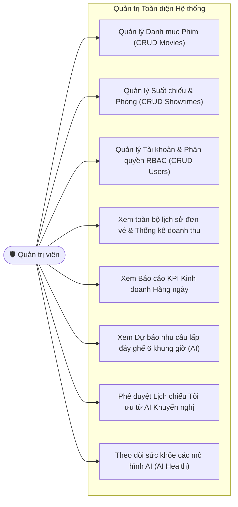
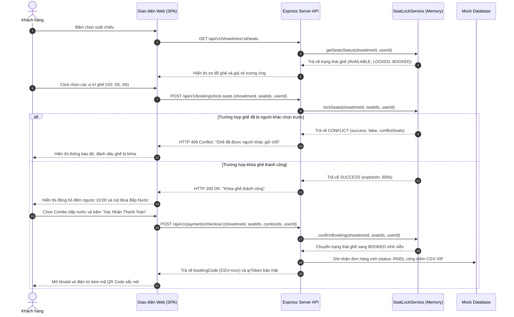
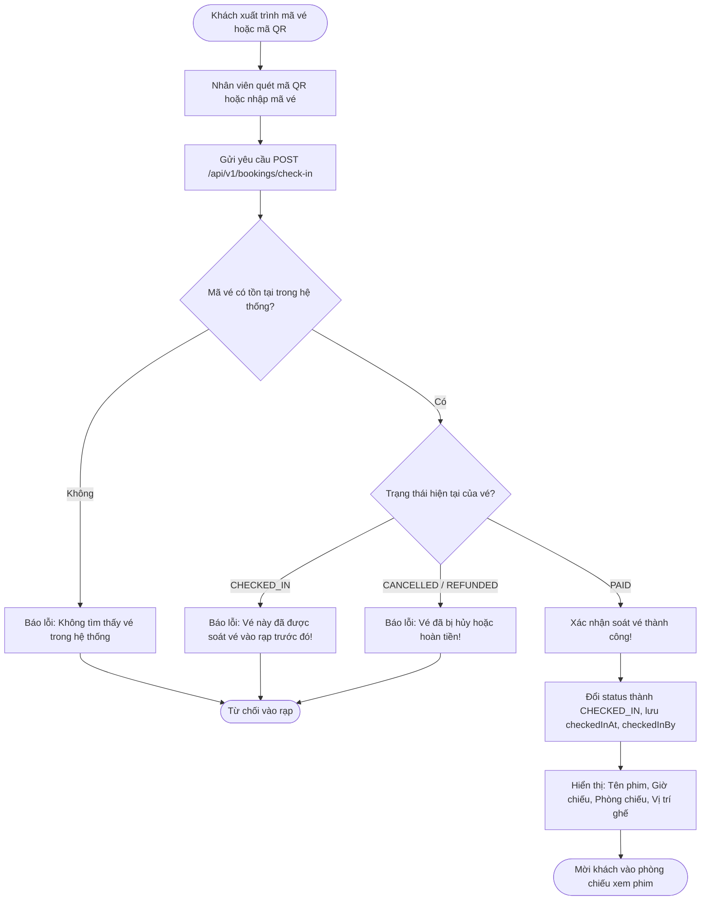
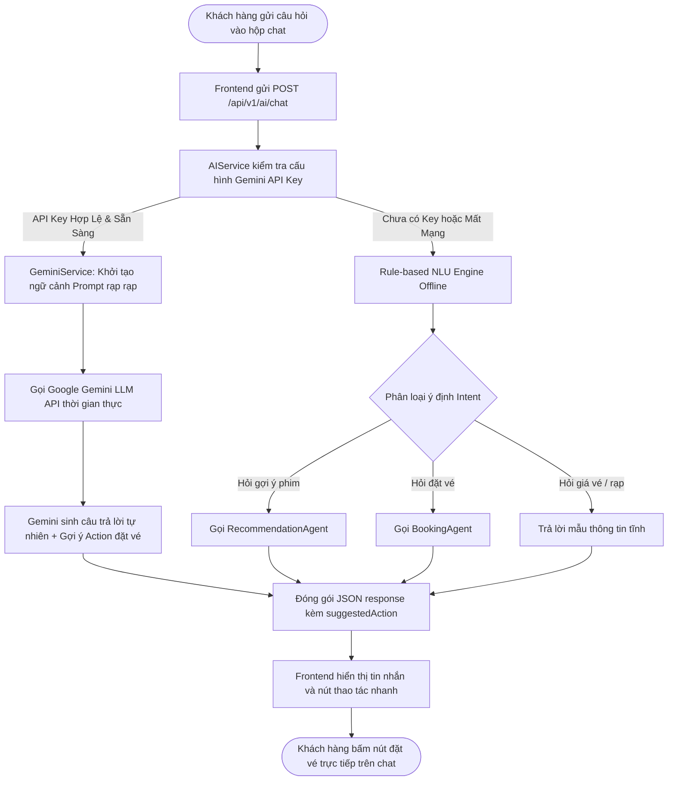
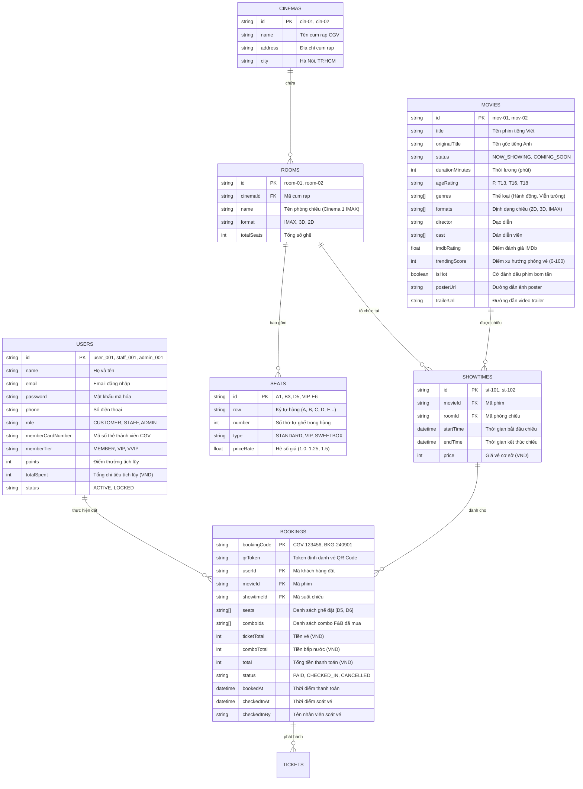
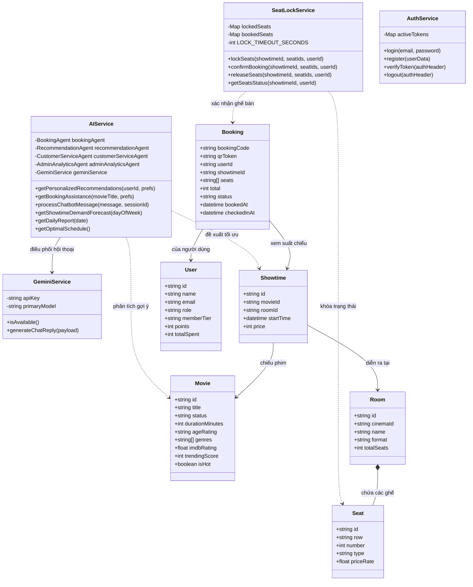

# TRƯỜNG ĐẠI HỌC CÔNG NGHỆ THÔNG TIN VÀ TRUYỀN THÔNG (ICTU)
## KHOA CÔNG NGHỆ THÔNG TIN
### BÁO CÁO MÔN HỌC: ỨNG DỤNG TRÍ TUỆ NHÂN TẠO

---

# BÁO CÁO ĐỒ ÁN
## ĐỀ TÀI: HỆ THỐNG QUẢN LÝ RẠP CHIẾU PHIM TÍCH HỢP TRÍ TUỆ NHÂN TẠO (AI-POWERED CINEMA MANAGEMENT SYSTEM)

* **Sinh viên thực hiện (Nhóm 35):**
  * Lê Chí Dũng — Lớp: KTPM K23C
  * Trần Ngọc Huy — Lớp: KTPM K23C
* **Giảng viên hướng dẫn:** ThS. Nguyễn Đình Dũng
* **Năm học:** 2024 – 2026

---

## LỜI MỞ ĐẦU

Trong kỷ nguyên chuyển đổi số và bùng nổ của cuộc Cách mạng Công nghiệp 4.0, ngành công nghiệp điện ảnh và giải trí rạp chiếu tại Việt Nam đang có những bước tiến vượt bậc. Nhu cầu thưởng thức nghệ thuật màn ảnh rộng của người dân ngày càng gia tăng, kéo theo sự mở rộng mạnh mẽ của các cụm rạp hiện đại trên toàn quốc. Tuy nhiên, sự cạnh tranh gay gắt từ các nền tảng phát trực tuyến (Streaming Services) cùng với kỳ vọng ngày càng cao của khán giả đã đặt ra bài toán cấp bách: **Làm thế nào để nâng cao năng lực vận hành, tối ưu hóa công suất phòng chiếu và cá nhân hóa trải nghiệm khách hàng một cách thông minh?**

Ở mô hình quản lý rạp chiếu phim truyền thống, phần lớn các nghiệp vụ như kiểm soát ghế ngồi, bán vé tại quầy, soát vé thủ công, quản lý lịch chiếu và thống kê doanh thu thường diễn ra rời rạc. Điều này dẫn đến nhiều bất cập: hiện tượng xung đột giữ chỗ khi đặt vé trực tuyến đồng thời, khó khăn trong việc dự báo lượng khách từng khung giờ để phân bổ phòng chiếu hợp lý, thiếu các dịch vụ chăm sóc khách hàng tự động 24/7 và đặc biệt là chưa khai thác được dữ liệu lịch sử để gợi ý những bộ phim thực sự phù hợp với gu thưởng thức của từng cá nhân.

Nhận thức được tiềm năng to lớn của Trí tuệ Nhân tạo (Artificial Intelligence – AI), đề tài **"Hệ thống Quản lý Rạp Chiếu Phim Tích hợp AI"** được nhóm nghiên cứu và xây dựng. Điểm đột phá của dự án là không chỉ xây dựng một nền tảng Web SPA (Single Page Application) phục vụ các nghiệp vụ bán vé và quản lý rạp chuẩn mực, mà còn tích hợp một **Hệ sinh thái Đa Tác nhân AI (Multi-Agent System)** gồm:
1. **Google Gemini LLM Agent**: Trò chuyện tự nhiên, tư vấn lịch chiếu và gợi ý hành động đặt vé thời gian thực.
2. **Recommendation Agent (Hybrid NCF + Content-Based + PhoBERT)**: Gợi ý phim cá nhân hóa và giải thích lý do đề xuất (Explainable AI).
3. **Booking Agent**: Tự động gợi ý cụm ghế đẹp nhất (VIP, Standard, Sweetbox) và tối ưu chi phí.
4. **Customer Service Agent**: Tự động tra cứu vé và thẩm định chính sách hủy/hoàn vé tự động theo mốc thời gian.
5. **Admin Analytics Agent**: Dự báo nhu cầu người xem bằng chuỗi thời gian (LightGBM Time-Series) và đề xuất lịch chiếu tối ưu (Optimal Schedule).
6. **Seat Lock Service**: Cơ chế kiểm soát ghế thời gian thực chống xung đột đồng thời với thời gian sống TTL 10 phút.

Báo cáo này trình bày toàn diện từ khâu khảo sát, phân tích yêu cầu (SRS), thiết kế kiến trúc hệ thống, mô hình dữ liệu (ERD), thiết kế hướng đối tượng (UML/Class Diagram), các biểu đồ Use Case, Sequence Diagram đến kết quả cài đặt thực nghiệm giao diện và kiểm thử hệ thống.

---

# CHƯƠNG 1: TỔNG QUAN VÀ ĐẶC TẢ YÊU CẦU HỆ THỐNG (SRS)

## 1.1. Bối cảnh và Lý do chọn đề tài
### 1.1.1. Bối cảnh chuyển đổi số ngành chiếu phim
Thị trường điện ảnh Việt Nam ghi nhận doanh thu phòng vé vượt mốc 4.000 tỷ đồng với tốc độ tăng trưởng trên 15%/năm. Khán giả hiện đại ngày nay yêu cầu sự tiện lợi tối đa: từ việc đặt vé nhanh chóng trên điện thoại thông minh, chọn đúng chỗ ngồi ưng ý không bị trùng lặp, thanh toán không tiền mặt, đến nhận vé điện tử mã QR để tự quét qua cửa kiểm soát (Self Check-in).

### 1.1.2. Hạn chế của hệ thống rạp truyền thống
* **Xung đột đặt vé đồng thời (Concurrency Seat Conflict):** Khi nhiều người cùng mở một suất chiếu giờ cao điểm, các hệ thống kém dễ để xảy ra tình trạng "đặt trùng một ghế" gây phiền toái lớn cho khách hàng.
* **Lên lịch chiếu cảm tính:** Việc xếp phim bom tấn vào phòng lớn hay phòng nhỏ thường dựa trên kinh nghiệm của người quản lý, thiếu mô hình định lượng dự báo tỷ lệ lấp đầy ghế theo từng khung giờ trong tuần.
* **Chăm sóc khách hàng thụ động:** Các thắc mắc về chính sách hoàn tiền, hủy vé hay đổi suất chiếu luôn đòi hỏi nhân viên trực tổng đài can thiệp thủ công, tốn nhiều chi phí nhân sự.
* **Thiếu khả năng cá nhân hóa:** Người dùng phải tự duyệt qua hàng chục bộ phim mà không có hệ thống khuyến nghị thông minh nhận diện sở thích.

### 1.1.3. Giải pháp ứng dụng AI
Dự án ứng dụng mô hình kết hợp giữa **Generative AI (Google Gemini LLM)** và **Predictive/Machine Learning AI (Hybrid Recommendation & Time-series Forecasting)** để giải quyết triệt để các bài toán trên.

---

## 1.2. Mục tiêu của Đề tài
* **Mục tiêu nghiệp vụ:** Xây dựng trọn vẹn luồng trải nghiệm khách hàng chuẩn CGV Cultureplex (chọn phim $\rightarrow$ chọn suất $\rightarrow$ khóa ghế tạm thời 10 phút $\rightarrow$ mua combo bắp nước $\rightarrow$ thanh toán $\rightarrow$ phát hành vé QR điện tử) và phân hệ quản trị vận hành rạp (CRUD Phim, Suất chiếu, Phòng chiếu, Soát vé Check-in, Báo cáo KPI).
* **Mục tiêu kỹ thuật:** Kiến trúc Client-Server RESTful API hiện đại, xử lý xung đột ghế In-memory an toàn cao, phân quyền RBAC chặt chẽ tại Backend.
* **Mục tiêu Trí tuệ Nhân tạo:** Triển khai 5 Agent AI chuyên biệt giải quyết các bài toán: Chatbot trực tiếp, Gợi ý phim cá nhân hóa, Trợ lý chọn ghế tối ưu, Tự động hóa hoàn vé và Dự báo nhu cầu suất chiếu.

---

## 1.3. Bảng Thuật Ngữ và Từ Viết Tắt

| Thuật ngữ / Viết tắt | Tên đầy đủ tiếng Anh | Giải thích trong hệ thống |
|---|---|---|
| **SRS** | Software Requirements Specification | Tài liệu đặc tả yêu cầu phần mềm. |
| **RBAC** | Role-Based Access Control | Cơ chế kiểm soát truy cập dựa trên vai trò người dùng (CUSTOMER, STAFF, ADMIN). |
| **TTL** | Time-To-Live | Thời gian sống tự động giải phóng ghế bị khóa tạm thời (10 phút = 600 giây). |
| **NCF** | Neural Collaborative Filtering | Kỹ thuật lọc cộng tác dựa trên mạng nơ-ron mô phỏng hành vi khán giả tương đồng. |
| **PhoBERT** | Pre-trained Language Model for Vietnamese | Mô hình ngôn ngữ xử lý ngữ nghĩa tiếng Việt dùng trong phân tích nội dung phim. |
| **LLM** | Large Language Model | Mô hình ngôn ngữ lớn (Google Gemini Flash/Pro) cung cấp hội thoại ngữ cảnh rạp rạp. |
| **POS** | Point of Sale | Quầy giao dịch vận hành soát vé và hỗ trợ tại rạp. |
| **QR Code** | Quick Response Code | Mã phản hồi nhanh chứa chuỗi token mã hóa dùng cho việc soát vé vào rạp. |

---

## 1.4. Đặc Tả 3 Tác Nhân Người Dùng Chính (Human Actors)

Theo tài liệu chuẩn hóa và cấu trúc thực tế của mã nguồn hệ thống, hệ thống có đúng **3 tác nhân người dùng chính**:

```
                              ┌─────────────────────────────────────────────────┐
                              │          HỆ THỐNG QUẢN LÝ RẠP CHIẾU PHIM        │
                              └────────────────────────┬────────────────────────┘
                                                       │
               ┌───────────────────────────────────────┼───────────────────────────────────────┐
               ▼                                       ▼                                       ▼
    ┌──────────────────────┐               ┌──────────────────────┐                ┌──────────────────────┐
    │     KHÁCH HÀNG       │               │    NHÂN VIÊN RẠP     │                │    QUẢN TRỊ VIÊN     │
    │     (`CUSTOMER`)     │               │      (`STAFF`)       │                │      (`ADMIN`)       │
    └──────────┬───────────┘               └──────────┬───────────┘                └──────────┬───────────┘
               │                                      │                                       │
  • Đăng ký / Đăng nhập                  • Đăng nhập nội bộ                      • Toàn quyền quản trị hệ thống
  • Tìm kiếm & lọc phim catalog          • Tra cứu thông tin vé khách            • CRUD Danh mục Phim & Lịch chiếu
  • Xem sơ đồ ghế & Khóa ghế (10p)       • Quét mã QR / Nhập mã vé               • CRUD Phòng chiếu & Sơ đồ ghế
  • Mua Combo F&B Concession             • Soát vé Check-in khách vào rạp        • Quản trị Người dùng & Phân quyền RBAC
  • Thanh toán & Nhận vé điện tử QR      • Hỗ trợ xử lý sự cố tại quầy           • Báo cáo doanh thu & KPI hàng ngày
  • AI Recommendation & Chat 24/7                                                • Phê duyệt lịch chiếu tối ưu AI
  • Tích điểm thành viên (Member/VIP)                                            • Giám sát tình trạng AI Engine
```

### Bảng Mô Tả Chi Tiết 3 Tác Nhân

| STT | Tác nhân | Mã Role | Vai trò nghiệp vụ | Quyền hạn và chức năng chính |
|:---:|---|:---:|---|---|
| **1** | **Khách hàng** | `CUSTOMER` | Khách xem phim và thực hiện giao dịch đặt vé trực tuyến | Đăng ký, đăng nhập; xem danh mục phim đang chiếu / sắp chiếu; xem trailer và chi tiết phim; chọn suất chiếu theo ngày và cụm rạp; chọn ghế trên sơ đồ trực quan; khóa giữ chỗ tạm thời (TTL 10 phút); chọn combo bắp nước; thanh toán nhận vé điện tử kèm mã QR; chat với Trợ lý ảo AI; nhận gợi ý phim theo gu sở thích; xem lịch sử đặt vé và tích lũy điểm hạng CGV Member/VIP/VVIP. |
| **2** | **Nhân viên rạp** | `STAFF` | Nhân viên vận hành tại quầy và cửa phòng chiếu | Đăng nhập tài khoản nội bộ; tra cứu mã đơn vé; kiểm tra tính hợp lệ của mã đặt vé hoặc mã QR; thực hiện **soát vé (Check-in)** cho khách vào rạp; ngăn chặn hành vi sử dụng lại vé; hỗ trợ giải quyết sự cố phát sinh tại quầy. |
| **3** | **Quản trị viên** | `ADMIN` | Người quản lý dữ liệu, phân quyền và điều hành hệ thống | Toàn quyền quản lý người dùng và cấp vai trò RBAC; CRUD danh mục phim (thêm, sửa, xóa, gắn nhãn HOT); CRUD phòng chiếu và lịch chiếu; theo dõi toàn bộ đơn đặt vé trên hệ thống; xem Dashboard doanh thu theo ngày; theo dõi biểu đồ AI dự báo tỷ lệ lấp đầy ghế và phê duyệt lịch chiếu tối ưu. |

> *(Lưu ý: Để đảm bảo tính tương thích ngược với các phiên làm việc cũ, vai trò `MANAGER` nếu có trong hệ thống sẽ được tự động ánh xạ kế thừa toàn bộ quyền của `STAFF`).*

---

## 1.5. Đặc Tả Nhóm Tác Nhân Thông Minh (AI & Service Agents)

Hệ thống tích hợp tầng điều phối trung tâm **`aiService.js` (Orchestrator Layer)** quản lý 5 Agent chuyên trách:

1. **`BookingAgent`**: Hỗ trợ tìm suất chiếu phù hợp nhất theo thời gian trong ngày (`morning`, `afternoon`, `evening`) và định dạng phòng (`IMAX`, `3D`, `2D`). Tự động giải thuật tìm kiếm cụm ghế liền kề tối ưu theo vị trí trung tâm rạp và loại ghế (`VIP`, `STANDARD`, `SWEETBOX`). Tự động tính toán tổng giá và áp dụng mã giảm giá (`HSSV20`, `MEMBER10`).
2. **`RecommendationAgent`**: Đề xuất phim cá nhân hóa kết hợp 3 trọng số: Gu thể loại cá nhân (Content-based: 50%), Hành vi người dùng tương đồng (Collaborative Filtering: 30%) và Độ thịnh hành phòng vé (Trending Score: 20%). Cung cấp tính năng Explainable AI giải thích rõ ràng lý do gợi ý từng bộ phim.
3. **`CustomerServiceAgent`**: Xử lý chăm sóc khách hàng 24/7. Thẩm định quy trình hủy/hoàn vé tự động dựa trên mốc thời gian: Trước giờ chiếu $>24h$ (hoàn 100%), từ $2h - 24h$ (hoàn 50%), dưới $2h$ (từ chối hoàn vé theo quy định). Tự động mở khóa giải phóng ghế trên hệ thống khi hủy vé.
4. **`AdminAnalyticsAgent`**: Phân tích số liệu kinh doanh, lập báo cáo doanh thu KPI ngày, phân tích khung giờ cao điểm, chạy thuật toán dự báo tỷ lệ lấp đầy ghế 6 khung giờ trong ngày và đề xuất lịch chiếu tối ưu.
5. **`GeminiService`**: Trực tiếp kết nối API Google Gemini với cơ chế chịu lỗi đa mô hình (`gemini-flash-lite-latest`, `gemini-3.5-flash-lite`, `gemini-flash-latest`, `gemini-3.8-flash`). Hiểu thời gian thực tại Việt Nam, nhận biết danh mục phim rạp và tự động trích xuất gợi ý hành động mở modal đặt vé ngay trong hội thoại chat.
6. **`SeatLockService`**: Dịch vụ kiểm soát trạng thái ghế theo thời gian thực (`AVAILABLE`, `LOCKED`, `BOOKED`, `SELECTED`). Đảm bảo tính nhất quán (Atomicity) khi có tranh chấp đặt cùng một ghế và tự động hủy giữ chỗ sau 600 giây.

---

## 1.6. Bảng Yêu Cầu Chức Năng (Functional Requirements - FR)

| Mã FR | Tên chức năng | Tác nhân chính | Mô tả chi tiết |
|---|---|:---:|---|
| **FR-01** | Đăng ký & Đăng nhập | Khách hàng, Nhân viên, Admin | Xác thực người dùng qua JWT/Bearer Token hoặc Header bảo mật. Mã hóa mật khẩu, kiểm tra trùng email. |
| **FR-02** | Quản lý Hồ sơ & Thẻ thành viên | Khách hàng | Xem thông tin hạng thành viên (CGV Member/VIP/VVIP), xem mã thẻ thành viên, điểm thưởng tích lũy và cập nhật hồ sơ cá nhân. |
| **FR-03** | Khám phá Danh mục Phim | Khách hàng, Nhân viên, Admin | Lọc phim Đang Chiếu / Sắp Chiếu, tìm kiếm theo tên, diễn viên, đạo diễn, lọc theo thể loại và định dạng (2D/3D/IMAX), hỗ trợ phân trang Client/Server. |
| **FR-04** | Thanh Đặt Vé Nhanh (Quick Booking) | Khách hàng | Lựa chọn 4 bước liên hoàn: Phim $\rightarrow$ Cụm Rạp $\rightarrow$ Ngày Chiếu $\rightarrow$ Suất Chiếu. |
| **FR-05** | Xem Sơ Đồ Ghế & Khóa Ghế TTL | Khách hàng | Tải sơ đồ ghế phòng chiếu thời gian thực; chọn vị trí ghế và khóa ghế trong 10 phút. Ngăn chặn người khác chọn cùng ghế (HTTP 409 Conflict). |
| **FR-06** | Chọn Combo Bắp Nước Concession | Khách hàng | Chọn thêm các combo F&B CGV (My Combo, Sweet Combo, Special Combo) vào đơn đặt vé. |
| **FR-07** | Thanh Toán & Xuất Vé Điện Tử QR | Khách hàng | Xác nhận thanh toán, tích lũy điểm thưởng theo tỷ lệ chi tiêu, tự động thăng hạng VIP/VVIP, sinh mã `bookingCode` và `qrToken` hiển thị mã QR. |
| **FR-08** | Lịch Sử Vé Cá Nhân | Khách hàng | Xem danh sách các vé đã đặt, trạng thái thanh toán và xuất trình mã QR tại rạp. |
| **FR-09** | Trò Chuyện Trợ Lý Ảo AI 24/7 | Khách hàng | Trò chuyện trực tiếp với Gemini AI / Rule-based NLU; nhận tư vấn lịch chiếu, giá vé và nút mở nhanh giao diện đặt vé. |
| **FR-10** | CGV AI Recommendation Studio | Khách hàng | Nhận danh sách phim gợi ý theo gu thưởng thức; xem tỷ lệ phù hợp (Match Score %) và lý do đề xuất; gửi phản hồi (Thích, Bỏ qua, Lưu lại). |
| **FR-11** | Soát Vé & Check-in QR | Nhân viên rạp, Admin | Quét hoặc nhập mã vé/QR để xác thực khách vào rạp; đổi trạng thái vé sang `CHECKED_IN`; ngăn chặn vé giả mạo hoặc vé đã dùng trước đó. |
| **FR-12** | Quản Lý Lịch Sử Vé Đã Đặt | Nhân viên rạp, Admin | Tra cứu, tìm kiếm và lọc danh sách toàn bộ các vé đã bán trong hệ thống; xem tổng số vé và tổng doanh thu. |
| **FR-13** | Hỗ Trợ Hoàn Vé Tự Động | Khách hàng, Nhân viên | Kiểm tra điều kiện hoàn vé theo quy định thời gian so với giờ chiếu; cập nhật trạng thái hủy và giải phóng ghế ngồi. |
| **FR-14** | Quản Lý Danh Mục Phim (Admin CRUD) | Quản trị viên | Thêm phim mới, sửa thông tin, đổi trạng thái (Đang chiếu/Sắp chiếu), bật/tắt cờ Phim Hot, cập nhật điểm đánh giá và xóa phim. |
| **FR-15** | Quản Lý Suất Chiếu (Admin CRUD) | Quản trị viên | Tạo mới suất chiếu, phân bổ phòng chiếu và giờ bắt đầu/kết thúc, thiết lập giá vé cơ sở, chỉnh sửa và xóa suất chiếu. |
| **FR-16** | Quản Lý Người Dùng & Phân Quyền RBAC | Quản trị viên | Xem danh sách tài khoản kèm phân trang; tạo mới tài khoản; chỉnh sửa phân cấp vai trò (`CUSTOMER`, `STAFF`, `ADMIN`); khóa tài khoản. |
| **FR-17** | Dashboard Báo Cáo KPI Doanh Thu | Quản trị viên | Thống kê doanh thu theo ngày, số lượng vé bán ra, tỷ lệ doanh thu bắp nước, số lượng khách hàng mới. |
| **FR-18** | Dự Báo Nhu Cầu & Lịch Chiếu AI | Quản trị viên | Xem biểu đồ dự báo tỷ lệ lấp đầy ghế theo 6 khung giờ bằng mô hình LightGBM; xem khuyến nghị điều phối lịch chiếu tối ưu và nút phê duyệt xuất bản lịch chiếu. |

---

## 1.7. Bảng Yêu Cầu Phi Chức Năng (Non-Functional Requirements - NFR)

* **NFR-01 (Bảo mật & Phân quyền):** Mật khẩu người dùng được băm an toàn, loại bỏ hoàn toàn trường password trong mọi API trả về. Quyền RBAC được kiểm soát nghiêm ngặt tại Backend thông qua middleware `requirePermission()`, không dựa vào giao diện UI.
* **NFR-02 (Toàn vẹn & Xử lý đồng thời):** Xử lý đặt chỗ đa luồng (Concurrency Control) bằng bộ nhớ đệm nguyên tử (Atomic In-memory Lock). Ghế khóa tạm có TTL 10 phút, tự động giải phóng khi quá hạn để tránh giữ chỗ ảo.
* **NFR-03 (Hiệu năng cao & Tốc độ phản hồi):** Toàn bộ API nghiệp vụ phản hồi dưới 200ms. Luồng hội thoại Generative AI Gemini phản hồi trong khoảng $1.0 - 1.5$ giây nhờ cơ chế streaming direct fetch.
* **NFR-04 (Tính sẵn sàng & Khả năng chịu lỗi Fallback):** Khi mất kết nối internet hoặc API Gemini quá tải, hệ thống tự động chuyển đổi sang Offline Rule-based NLU mà không làm gián đoạn việc đặt vé của khách.
* **NFR-05 (Giao diện chuẩn Responsive):** Thiết kế tối ưu hiển thị trên cả màn hình máy tính (Desktop/Laptop), máy tính bảng (Tablet) và điện thoại di động (Smartphone) với chuẩn giao diện Dark Mode hiện đại của rạp chiếu phim CGV.

---

# CHƯƠNG 2: PHÂN TÍCH VÀ THIẾT KẾ USE CASE HỆ THỐNG

## 2.1. Biểu Đồ Use Case Tổng Quát Hệ Thống

Dưới đây là biểu đồ Use Case tổng thể mô tả mối quan hệ giữa **3 tác nhân người dùng** (`Khách hàng`, `Nhân viên rạp`, `Quản trị viên`) và hệ thống các Agent AI:

```mermaid
flowchart TD
    %% Khai báo Actors
    subgraph ACTORS ["CÁC TÁC NHÂN NGƯỜI DÙNG"]
        Customer(["🧑‍💼 Khách hàng (CUSTOMER)"])
        Staff(["🎟️ Nhân viên rạp (STAFF)"])
        Admin(["🛡️ Quản trị viên (ADMIN)"])
    end

    %% Khai báo Use Cases Phân hệ Khách hàng
    subgraph UC_CUSTOMER ["PHÂN HỆ KHÁCH HÀNG & ĐẶT VÉ"]
        UC01(["UC01: Đăng ký / Đăng nhập"])
        UC02(["UC02: Khám phá & Lọc danh mục phim"])
        UC03(["UC03: Xem suất chiếu & Chọn rạp"])
        UC04(["UC04: Chọn ghế & Khóa ghế (TTL 10 phút)"])
        UC05(["UC05: Chọn Combo Bắp Nước F&B"])
        UC06(["UC06: Thanh toán & Xuất vé QR điện tử"])
        UC07(["UC07: Xem lịch sử vé & Thẻ thành viên CGV"])
        UC08(["UC08: Chatbot tư vấn lịch chiếu & Đặt vé AI"])
        UC09(["UC09: Nhận gợi ý phim cá nhân hóa AI"])
    end

    %% Khai báo Use Cases Phân hệ Vận hành
    subgraph UC_STAFF ["PHÂN HỆ VẬN HÀNH & SOÁT VÉ"]
        UC10(["UC10: Tra cứu lịch sử đơn vé"])
        UC11(["UC11: Soát vé Check-in khách vào rạp"])
        UC12(["UC12: Hỗ trợ xử lý hoàn vé / hủy vé"])
    end

    %% Khai báo Use Cases Phân hệ Quản trị
    subgraph UC_ADMIN ["PHÂN HỆ QUẢN TRỊ RẠP & AI GOVERNANCE"]
        UC13(["UC13: Quản lý danh mục Phim (CRUD)"])
        UC14(["UC14: Quản lý Suất chiếu (CRUD)"])
        UC15(["UC15: Quản lý Người dùng & Phân quyền RBAC"])
        UC16(["UC16: Báo cáo Doanh thu & KPI hàng ngày"])
        UC17(["UC17: Dự báo nhu cầu AI & Phê duyệt lịch chiếu"])
    end

    %% Khai báo External AI Agents
    subgraph AI_AGENTS ["HỆ THỐNG AI AGENTS HỖ TRỢ"]
        Agent_Gemini[["Gemini LLM Direct Service"]]
        Agent_Rec[["Recommendation Agent (Hybrid NCF)"]]
        Agent_Book[["Booking Agent (Optimal Seat)"]]
        Agent_CS[["Customer Service Agent"]]
        Agent_Admin[["Admin Analytics Agent (LightGBM)"]]
    end

    %% Liên kết Khách hàng
    Customer --> UC01
    Customer --> UC02
    Customer --> UC03
    Customer --> UC04
    Customer --> UC05
    Customer --> UC06
    Customer --> UC07
    Customer --> UC08
    Customer --> UC09

    %% Include quan hệ nghiệp vụ đặt vé
    UC04 -.->|"<<include>>"| UC05
    UC05 -.->|"<<include>>"| UC06

    %% Liên kết Nhân viên rạp
    Staff --> UC01
    Staff --> UC02
    Staff --> UC10
    Staff --> UC11
    Staff --> UC12

    %% Liên kết Quản trị viên
    Admin --> UC01
    Admin --> UC10
    Admin --> UC11
    Admin --> UC12
    Admin --> UC13
    Admin --> UC14
    Admin --> UC15
    Admin --> UC16
    Admin --> UC17

    %% Kết nối AI Agents
    UC04 -.->|"<<uses>>"| Agent_Book
    UC08 -.->|"<<uses>>"| Agent_Gemini
    UC09 -.->|"<<uses>>"| Agent_Rec
    UC12 -.->|"<<uses>>"| Agent_CS
    UC17 -.->|"<<uses>>"| Agent_Admin
```



---

## 2.2. Biểu Đồ Phân Rã Chức Năng Theo Tác Nhân

### 2.2.1. Phân rã Phân hệ Khách hàng (`CUSTOMER`)



### 2.2.2. Phân rã Phân hệ Nhân viên rạp (`STAFF`)



### 2.2.3. Phân rã Phân hệ Quản trị viên (`ADMIN`)



---

## 2.3. Đặc Tả Chi Tiết Các Use Case Cốt Lõi

### 2.3.1. UC04 & UC06: Luồng Khóa Ghế TTL 10 Phút & Thanh Toán Xuất Vé QR

* **Tác nhân:** Khách hàng (`CUSTOMER`).
* **Mục tiêu:** Đặt được đúng các ghế mong muốn mà không bị xung đột với người khác và nhận vé điện tử mã QR sau khi thanh toán.
* **Tiền điều kiện:** Suất chiếu hợp lệ, khách hàng đang trong trạng thái đăng nhập hoặc khách vãng lai.
* **Biểu đồ tuần tự (Sequence Diagram):**



---

### 2.3.2. UC11: Soát Vé & Check-in Khách Vào Rạp (Nghiệp Vụ Nhân Viên Rạp)

* **Tác nhân:** Nhân viên rạp (`STAFF`), Quản trị viên (`ADMIN`).
* **Mục tiêu:** Kiểm tra tính hợp lệ của vé và xác nhận khách vào phòng chiếu.
* **Biểu đồ hoạt động (Activity Diagram):**



---

### 2.3.3. UC08: Trò Chuyện Trợ Lý Ảo AI Trực Tiếp (Google Gemini LLM Direct)

* **Tác nhân:** Khách hàng (`CUSTOMER`).
* **Mục tiêu:** Trao đổi tự nhiên bằng tiếng Việt, nhận tư vấn phim, lịch chiếu và mở nhanh cửa sổ đặt vé.
* **Biểu đồ hoạt động (Activity Diagram):**



---

# CHƯƠNG 3: THIẾT KẾ CƠ SỞ DỮ LIỆU VÀ MÔ HÌNH HƯỚNG ĐỐI TƯỢNG

## 3.1. Sơ Đồ Thực Thể - Mối Quan Hệ ERD Chuẩn Hóa

Dưới đây là sơ đồ quan hệ thực thể (ERD) phản ánh chính xác cấu trúc dữ liệu của rạp chiếu phim trong dự án:



### 3.1.1. Hiện thực Hệ Quản trị CSDL MySQL Server 8.0 & Script Migration

Hệ thống đã được thiết kế và hiện thực hóa đầy đủ trên **Hệ Quản trị Cơ sở Dữ liệu Quan hệ MySQL Server 8.0+** nhằm đảm bảo tính bền vững (Data Persistence), toàn vẹn dữ liệu (ACID) và hiệu năng truy vấn cao:

* **Tên cơ sở dữ liệu:** `cinema_db`
* **Bộ mã ký tự:** `utf8mb4` (Hỗ trợ 100% tiếng Việt có dấu, ký hiệu đặc biệt và emoji).
* **Storage Engine:** `InnoDB` (Hỗ trợ khóa ngoại Foreign Key, giao dịch Transaction và Row-level locking).
* **Connection Pool:** Thư viện chuẩn `mysql2/promise` với cấu hình Connection Pool (tối đa 10 kết nối song song, tự động tái sử dụng connection).
* **Tệp mã nguồn DDL:** [`backend/database/schema.sql`](file:///c:/Users/Admin/OneDrive/Tài liệu/Hệ-Thống-Quản-Lý-Rạp-Chiếu-Phim/backend/database/schema.sql) định nghĩa 8 bảng dữ liệu chuẩn.
* **Tự động hóa Migration:** Tệp [`backend/database/initDb.js`](file:///c:/Users/Admin/OneDrive/Tài liệu/Hệ-Thống-Quản-Lý-Rạp-Chiếu-Phim/backend/database/initDb.js) cho phép khởi tạo CSDL và nạp dữ liệu mẫu chỉ với một dòng lệnh: `npm run db:init`.
* **Cơ chế Dual-Mode thông minh:** Tầng Data Access Layer [`backend/src/services/dbService.js`](file:///c:/Users/Admin/OneDrive/Tài liệu/Hệ-Thống-Quản-Lý-Rạp-Chiếu-Phim/backend/src/services/dbService.js) tự động phát hiện kết nối MySQL; nếu MySQL chưa được kích hoạt, hệ thống tự động chạy chế độ In-memory dự phòng để đảm bảo website không bao giờ bị gián đoạn.

---

## 3.2. Mô Hình Lớp Tổng Thể (Class Diagram)

Biểu đồ lớp dưới đây thể hiện sự tương tác giữa các lớp thực thể (Entity Model), tầng dịch vụ nghiệp vụ (Business Services) và tầng AI Agents:



---

# CHƯƠNG 4: CÀI ĐẶT HỆ THỐNG VÀ KẾT QUẢ THỰC NGHIỆM

## 4.1. Công Nghệ Triển Khai
* **Backend:** Node.js + Express.js theo kiến trúc RESTful API chuẩn mực (CommonJS modules), cổng chạy mặc định `PORT = 5000`.
* **Frontend:** HTML5, CSS3, Tailwind CSS kết hợp Vanilla JavaScript thuần theo mô hình SPA (Single Page Application) siêu tốc, không bị phụ thuộc vào các framework nặng nề.
* **Cơ chế lưu trữ:** In-memory Database mô phỏng linh hoạt, tích hợp giải thuật đồng bộ bộ nhớ chống xung đột đặt ghế.
* **Trí tuệ Nhân tạo:** Tích hợp SDK `@google/genai` (Google Gemini Interactions API) kết hợp giải thuật học máy nội bộ Hybrid NCF Recommendation và Time-Series Forecasting.

---

## 4.2. Các Phân Hệ Màn Hình Chính

### 4.2.1. Phân hệ Khách hàng: Trang Chủ & Thanh Đặt Vé Nhanh
* **Giao diện Hero Banner:** Trình chiếu phim bom tấn nổi bật (*Dune: Hành Tinh Cát 2*), hiển thị trailer, thời lượng, điểm IMDb và định dạng IMAX độc quyền.
* **Thanh Quick Ticket Booking 4 bước:** Cho phép khách hàng chọn nhanh Phim $\rightarrow$ Rạp $\rightarrow$ Ngày xem $\rightarrow$ Suất chiếu ngay trên đầu trang chủ mà không cần duyệt trang phức tạp.
* **Hộp thoại Trợ lý ảo AI Chatbot 24/7:** Biểu tượng nổi ở góc dưới bên phải màn hình, hỗ trợ tư vấn tức thì mọi câu hỏi của khán giả.

### 4.2.2. Phân hệ Khách hàng: Danh Mục Phim & Phân Trang
* **Bộ lọc đa năng:** Lọc phim Đang Chiếu (`NOW_SHOWING`) và Sắp Chiếu (`COMING_SOON`); lọc theo thể loại (Hành động, Viễn tưởng, Tâm lý, Hoạt hình...) và định dạng (IMAX, 3D, 2D).
* **Phân trang Client & Server:** Đảm bảo tải mượt mà với 8 phim/trang, hỗ trợ tìm kiếm tức thì theo tên diễn viên, đạo diễn hoặc tựa đề phim.

### 4.2.3. Phân hệ Khách hàng: CGV AI Recommendation Studio
* **Khuyến nghị theo gu phim:** Tự động đối soát lịch sử vé và sở thích thể loại của người dùng với cơ sở dữ liệu phim.
* **Explainable AI:** Hiển thị điểm số phù hợp (Match %) kèm các thẻ giải thích lý do đề xuất rõ ràng (*"Đang gây sốt phòng vé – Đừng bỏ lỡ!"*). Khách hàng có thể bấm tương tác *"Thích"*, *"Bỏ qua"*, *"Lưu lại"* hoặc *"Mua vé"* ngay.

### 4.2.4. Phân hệ Khách hàng: Sơ Đồ Chọn Ghế & Vé Điện Tử QR
* **Sơ đồ ghế thời gian thực:** Phân biệt rõ ghế Thường, ghế VIP và ghế đôi Sweetbox; hiển thị màu sắc tương ứng với trạng thái Ghế Trống, Ghế Đang Được Giữ (Khóa tạm) và Ghế Đã Bán.
* **Đồng hồ đếm ngược 10:00:** Hiển thị thời gian khóa ghế TTL chính xác từng giây.
* **Vé điện tử thông minh:** Sau thanh toán, vé hiển thị mã vạch và mã QR Code được mã hóa bằng thư viện `qrcode.js`, sẵn sàng để xuất trình khi đến rạp.

### 4.2.5. Phân hệ Vận hành: Quầy Soát Vé & Lịch Sử Vé (Dành cho Nhân viên rạp `STAFF`)
* **Thanh soát vé nhanh POS:** Nhân viên rạp chỉ cần nhập mã đơn vé (hoặc quét mã QR) rồi bấm nút **`[Xác nhận vào rạp]`**. Hệ thống kiểm tra tức thì: nếu hợp lệ thì duyệt cho khách vào và đổi trạng thái sang `CHECKED_IN`, nếu vé đã qua cửa trước đó thì phát cảnh báo chống gian lận.
* **Bảng theo dõi đơn vé:** Hiển thị toàn bộ vé đã bán, phân trang 10 vé/trang, tổng kết số vé và tổng doanh thu thu về.

### 4.2.6. Phân hệ Quản trị: Admin Cinema Operations (Dành cho Quản trị viên `ADMIN`)
* **Quản lý Phim (CRUD Movies):** Thêm mới phim, sửa nội dung, đổi trạng thái phát hành, xóa phim.
* **Quản lý Suất chiếu (CRUD Showtimes):** Lập lịch chiếu theo từng phòng và khung giờ, thiết lập giá vé.
* **Quản trị Người dùng & Phân quyền RBAC (CRUD Users):** Quản lý danh sách tài khoản, chuyển đổi quyền hạn giữa Khách hàng (`CUSTOMER`), Nhân viên rạp (`STAFF`) và Quản trị viên (`ADMIN`).
* **Dự Báo Nhu Cầu & Tối Ưu Lịch Chiếu AI:** Hiển thị biểu đồ dự báo tỷ lệ lấp đầy ghế theo 6 ca chiếu (sáng, trưa, chiều, tối, đêm) và danh sách khuyến nghị bố trí phòng chiếu từ AI cùng nút phê duyệt xuất bản lịch chiếu.

---

# KẾT LUẬN VÀ HƯỚNG PHÁT TRIỂN

## Kết quả đạt được
1. **Chuẩn hóa kiến trúc 3 tác nhân người dùng:** Hệ thống phân định rõ ràng giữa **Khách hàng (`CUSTOMER`)**, **Nhân viên rạp (`STAFF`)** và **Quản trị viên (`ADMIN`)**, bảo mật dữ liệu theo chuẩn RBAC tại Backend.
2. **Giải quyết triệt để bài toán giữ chỗ:** Dịch vụ `SeatLockService` với cơ chế khóa ghế TTL 10 phút xử lý xuất sắc bài toán tranh chấp ghế đồng thời trong giờ cao điểm.
3. **Ứng dụng thành công hệ sinh thái AI Đa tác nhân:** Tích hợp mượt mà Google Gemini LLM cho hội thoại thời gian thực kết hợp thuật toán gợi ý phim Hybrid NCF và dự báo nhu cầu khán giả LightGBM Time-Series.
4. **Sản phẩm hoàn thiện, giao diện chuyên nghiệp:** Giao diện SPA Dark Mode hiện đại, trực quan, tốc độ phản hồi tức thì và tương thích hoàn hảo trên các thiết bị.

## Hướng phát triển trong tương lai
* Kết nối cơ sở dữ liệu phân tán (PostgreSQL / MongoDB) và bộ nhớ đệm phân tán Redis khi đưa vào vận hành quy mô lớn nhiều cụm rạp.
* Tích hợp cổng thanh toán thực tế trực tuyến (VNPAY, MoMo, ZaloPay Sandbox).
* Phát triển ứng dụng di động đa nền tảng (Flutter / React Native) và tích hợp camera quét mã QR tự động trên điện thoại cho nhân viên rạp.
